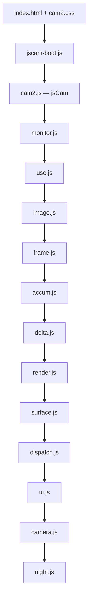
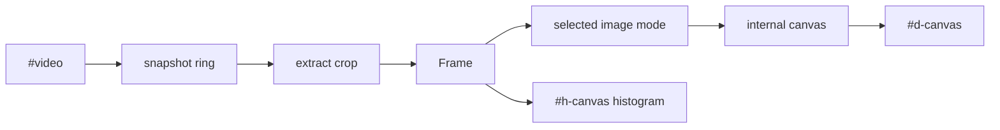

# JSCam

Live camera image-processing bench in the browser. Grayscale, edges, histogram, and frame-delta modes run on the capture stream. Sources are static files in `jscam/` (no bundler).

Processing stays in the page. Camera frames are not uploaded; GitHub Pages and the local nginx container only serve static files.

## Use

Open **https://mfujimoto-code.github.io/JSCam/jscam** over HTTPS, allow the camera, then **Start camera**.

Tap the image to hide or show controls. Implementation version is at the bottom of Controls.

The camera API needs a [secure context](https://developer.mozilla.org/en-US/docs/Web/Security/Secure_Contexts): this Pages URL, or localhost.

## Local

```bash
docker compose up -d
```

Then open `http://127.0.0.1:8888/` or `https://localhost:8888/` (self-signed cert). Plain HTTP on a LAN IP will not start the camera.

## Layout

`index.html` loads only `jscam-boot.js`. Boot inserts the live scripts in this order, then calls `jsCam.kick`. The path array in `jscam-boot.js` is the canonical set.



Roles, in that same order: namespace → buffer observation → typed-array scratch → convert/kernels → this-vis pixels → EMA → residual → image modes → canvas I/O → vis pipeline → controls → getUserMedia → Night Vision.

Architecture, decisions, and coding rules: [`jscam/cam2-design.md`](jscam/cam2-design.md).

## Processing

Each vis (one processed picture) stays on the main thread:



1. Camera frames land on a short snapshot ring.
2. The current vis extracts a center crop (zoom / pan) into a `Frame`.
3. The selected mode builds an output image (gray, edges, equalize, accum, delta, Night Vision, …).
4. That image is shown on `#d-canvas`. An optional histogram overlay is drawn on `#h-canvas`.

Nothing in this path is posted to a server. The host only delivers the HTML / CSS / JS.
